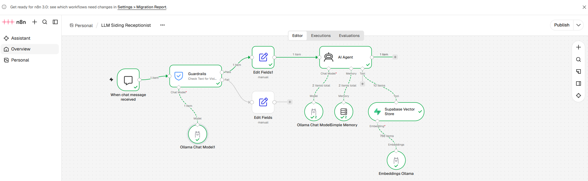

# n8n-ai-chat-agent
# AI-Powered Customer Support Agent for Siding Services

An AI-powered customer support prototype built with **n8n, Ollama, Llama 3.2 and Supabase**. The application answers customer questions about siding products, materials, installation and services using a dedicated knowledge base.

This project demonstrates how workflow automation, large language models (LLMs) and vector-based knowledge retrieval can be combined to build a conversational customer support solution.

> **Project status:** Prototype  
> **Data:** Synthetic demonstration data  
> **Purpose:** Independent portfolio project. 

## Project Overview

Customers often have questions about siding materials, installation options, maintenance and project requirements. Finding accurate information can take time, particularly when information is spread across different documents and resources.

This prototype explores how an AI assistant can make that information accessible through a conversational interface.

The assistant retrieves relevant information from a Supabase knowledge base and uses an LLM to formulate natural-language responses.

## Workflow Overview

## Project Demo
[Click here to open the GIF](./ai-chat-agent-siding.gif)

## Architecture

The application uses n8n to manage the conversation and connect the different components.

**Main workflow:**

1. A customer submits a question through the chat interface.
2. Guardrails check incoming messages for potential jailbreak attempts.
3. The AI Agent processes the question.
4. The agent retrieves relevant information from the Supabase knowledge base when needed.
5. Ollama runs the Llama 3.2 model locally to generate the response.
6. The answer is returned to the customer.

## Technology Stack

| Technology | Purpose |
|---|---|
| n8n | Workflow automation and AI orchestration |
| Ollama | Local LLM runtime |
| Llama 3.2 | Language model |
| Qwen2.5:7b |Language model |
| Supabase | Knowledge base and vector storage |
| Vector search | Retrieval of relevant knowledge |
| GitHub | Workflow versioning and project documentation |

## Key Features

### AI-Powered Customer Support
- Answers questions about siding products, materials and services.
- Provides conversational responses rather than requiring customers to search through documents.
- Uses a dedicated knowledge base for company-specific information.

### Knowledge Base Integration
- Stores synthetic siding-related information in Supabase.
- Uses vector-based retrieval to find relevant information.
- Allows the AI Agent to use retrieved content when answering customer questions.

### Security and Response Restrictions
- Implements jailbreak detection through Guardrails.
- Uses system instructions to define the assistant's role and response boundaries.
- Includes restrictions against exposing internal instructions or inventing company-specific information.
- Tests responses to unrelated questions and attempts to override the assistant's instructions.

### Responsible Quote Handling
The assistant is designed not to generate guaranteed project estimates or firm installation quotes.

For example, when asked whether a firm quote can be provided from a photograph, it explains that photographs cannot reliably establish measurements, access conditions, hidden damage, substrate condition or all finishing requirements.

A site assessment is necessary for a dependable quote.

## Example Customer Questions

The prototype is designed to handle questions such as:

- What siding materials are available?
- What is the difference between vinyl and fiber cement siding?
- What factors affect siding installation costs?
- What should I consider before replacing my siding?
- What maintenance does siding require?

## Getting Started

### Prerequisites

- n8n
- Ollama
- Llama 3.2 model
- Qwen2.5:7b model
- Supabase project
- A Supabase database configured for vector storage

### Setup

1. Install and configure n8n.
2. Install Ollama and download the Llama 3.2 model.
3. Configure your Supabase project and vector storage.
4. Import the workflow JSON from the `workflows` directory into n8n.
5. Configure the required credentials and connections.
6. Load the sample knowledge-base data into Supabase.
7. Activate the workflow and test it through the chat interface.

## What I Learned

This project provided practical experience with:

- Designing AI-powered workflows using n8n.
- Integrating locally hosted language models using Ollama.
- Connecting LLMs to external knowledge sources.
- Implementing vector-based knowledge retrieval.
- Structuring synthetic data for AI applications.
- Defining system instructions and response boundaries.
- Testing AI behavior, including jailbreak attempts and unrelated questions.
- Troubleshooting integrations between different services.

## Future Improvements

Potential next steps include:

- Improve topic classification to reduce false-positive rejections.
- Expand the knowledge base with additional product and service information.
- Add voice-based customer interactions.
- Improve conversation memory and context management.
- Add automated evaluation tests for answer accuracy and security.
- Introduce monitoring and logging for workflow performance.
